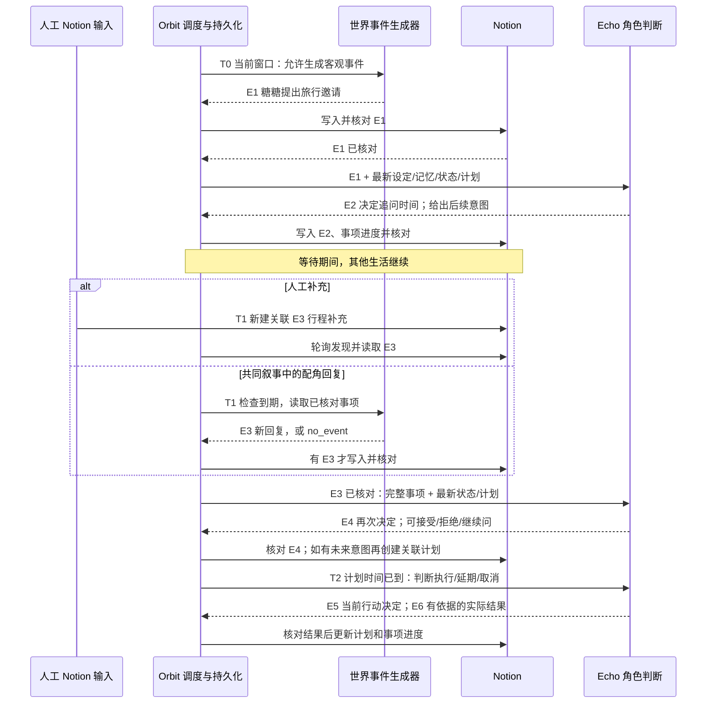

# 事件后续链实现规格与开发计划

版本：v1，2026-10-16，Asia/Shanghai。状态：**本地实现、虚构回归及一次有限真实隔离验收已完成；生产启用、部署与长期运行尚未验收**。证据、实现细节和未覆盖范围见 [实现记录](event-continuation-implementation.md) 与 [真实验收报告](event-continuation-live-acceptance-2026-10-16.md)。下文保留原设计目标与验收标准，不把目标文字当作实测证明。

本文件把“Echo 追问旅行时间后，收到补充信息能接续判断；关联原事件、回应和结果，并在 Notion 显示处理进度”展开为下一轮可实施范围。基线为本地提交 `70fed34`；既有实现和验收证据见 [implementation.md](implementation.md) 与 [联调报告](live-acceptance-2026-10-16.md)。本文件中的新结构、字段、命令、测试均为开发目标，不代表已经存在或通过验收。

## 1. 本轮目标与范围

让一个需要后续的事件具有稳定的“事项”身份，保存因果关系、等待条件和处理进度。新信息到达后，Orbit 重新读取最新资料，主动触发 Echo 判断；形成未来计划后，在实际时间到达时再次判断，并把实际执行结果关联回来。

包括：事项持久化、人工补充与虚构配角回复、按事项检索历史、必要的到期调度、依赖写回、Notion 事项进度、故障恢复和回归测试。继续使用 Python 标准库、SQLite、现有 OpenAI 兼容模型配置和 Notion 适配器。

不在本轮建设聊天界面、真实消息渠道、通知、多角色独立进程、完整导演系统、全库语义检索或云部署。虚构配角的回复是共同叙事中的新事件，不会向真实人物发送信息。

### 1.1 “补充信息”具体是什么

补充信息是当前决定所缺少、后来有来源的新内容。例如，Echo 认为旅行日期会影响自己是否参加，先问日期；后来收到“拟定某日出发”的新回复，才据此重新判断。日期、目的地、同行人、时长、预算都只是可能的问题，不能变成每次必填的固定问卷。

合法来源有两种：

1. 人工在 Notion 新建补充事件，明确关联原事项或事件；保留其原文和信息性质。
2. Orbit 在后续实时窗口生成符合既有事实的虚构配角新回复，标记共同叙事、事件提供者与执行者。不能把新内容改写进原邀请，冒充当时已经知道；不能虚构 Neo 的真实话语、行为或现实事实。

Echo 可以直接接受、拒绝、提出条件、暂缓、追问或不行动。不要求一定追问，不规定配角一定回复，也不规定最终接受、开心或关系改善。

## 2. 不可破坏的规则

- Orbit 负责客观世界、调度、协议校验、持久化、写入和读回核对；Echo 负责自己的理解、感受、决定和未来意图。技术上由 Orbit 调用模型不改变判断主体。
- 外部事件、Echo 判断、未来意图、实际执行结果独立记录并关联。先前的意图不能充当实际执行证据。
- Notion 是身份、记忆和生活记录的权威维护中心；SQLite 是运行索引与恢复日志。人工修改、删除、失效和确认状态必须重新读取并生效。
- 真实时间固定 Asia/Shanghai；存储使用带时区的 UTC。`occurred_at`（故事发生时间）、`generated_at`（生成时间）、`due_at`（下次检查时间）、`verified_at`（写回核对时间）分开。
- `due_at` 到达只表示允许检查，不证明对方已经回复、Echo 已行动或计划已完成。
- 上游事件必须先写入 Notion 并核对，才能触发依赖它的新判断。允许同一模型服务分别承担世界生成和 Echo 判断，不要求多模型或多 Agent。
- 等待一条回复不能暂停其他事项或日常生活；涉及同一状态或来源版本的写入仍须串行校验。
- 暂停停止新剧情和新角色判断；已生成内容的写回与核对允许恢复。重启不补剧情，过期任务在当前时刻重新评估。
- 不增加关系分值、固定情绪、必然回复或必然接受机制。敏感事项、核心身份及重大关系变化继续走既有边界。

## 3. 触发图与逐步结果

下面所有旅行内容均为**虚构流程示例，不是已发生的 Notion 历史**。T0、T1、T2 表示先后真实窗口，不是固定延迟。E1—E6 是示例事件名称，不是全局固定 ID。



图中 `no_event` 不会走“收到新回复”的判断路径；它走第 7 节的等待复评路径。E5、E6 可在同次模型调用中返回，但必须是两个有明确因果和时间的节点；完成计划的写入依赖 E6 核对。

| 步骤 | 触发者 → 接收方 | 触发路径 | 触发时间 | 事件或任务名称 | 结果与下一步 |
| --- | --- | --- | --- | --- | --- |
| 1 | Orbit 调度 → 世界生成器；或人工 → Notion | 正常生活窗口；或新增人工事件 | 当前窗口，不生成未来已发生事件 | E1 旅行邀请 / `world_check` | 产生客观邀请，保留信息性质、提供者和未知项 |
| 2 | Orbit outbox → Notion | 持久写任务、稳定标识、读回核对 | E1 本地提交后；故障按退避重试 | `publish_node(E1)` | 取得远端 ID 和核对回执；此前不触发 Echo |
| 3 | E1 核对回执 → Echo | `echo_decision`，读取事项及最新资料 | 同轮可继续；若已延迟则在新的当前窗口判断 | E2 追问日期 | 记录 Echo 的主观判断与提问；不是系统替她预设问题 |
| 4 | Orbit outbox → Notion / 调度索引 | 核对 E2，再发布事项投影 | E2 生成后 | `publish_node(E2)` / `project_thread` | 事项显示等待补充；保存检查时间，其他生活继续 |
| 5A | 人工 → Notion → Orbit 输入轮询 | 新补充事件显式关联事项/父事件 | 下一次输入轮询，且发生时间不在未来 | E3 行程补充 | 原文和来源纳入事项；不重复生成同一份配角回复 |
| 5B | Orbit 到期任务 → 世界生成器 | `world_check`；基于 E1、E2 及最新上下文 | 不早于 `due_at`，只在当前实时窗口 | E3 配角新回复，或 `no_event` | 有回复才生成新事件；无回复不编造对话 |
| 6 | Orbit → Notion → Echo | 核对 E3，再创建唯一 `echo_decision` | E3 已核对且来源版本有效后 | E4 再次判断 | 接受、拒绝、暂缓、再问或不行动，关联 E1—E3 |
| 7 | Orbit outbox → Notion 计划库 | E4 明确未来意图，核对来源关系 | 意图形成时；计划时间可在未来 | P1 旅行计划 | 计划初始待执行，来源事件指向 E4，不写成已参加 |
| 8 | Orbit 到期任务 → Echo | `plan_review`，读取最新计划及资料 | 计划时间到达或停机恢复后的当前时刻 | E5 当前行动决定 | 选择执行、延期、取消等；超时不是已完成 |
| 9 | Echo 结果 → Orbit → Notion | `execution_result` 核对，再更新计划/事项 | 实际结果发生于允许的实时窗口 | E6 实际结果 | 只有有依据的完成结果才能标记计划完成；否则保留进行中/延期/取消 |

## 4. 事项与节点模型

### 4.1 事项状态与同步状态分离

事项业务状态：

| 状态 | 含义 | 允许的推进 |
| --- | --- | --- |
| `awaiting_echo` | 有已核对输入，等待 Echo 当前判断 | 判断后进入以下任一状态 |
| `awaiting_world` | Echo 决定等待补充，或暂缓并等待条件 | 新输入到达转 `awaiting_echo`；检查无回复可继续等待或触发复评 |
| `decided` | 当前问题已有决定，可能还有未来计划 | 有新信息可重新判断；计划结果到达再核对结案 |
| `closed` | Echo 明确结束，且不存在未交代的后续计划 | 明确的新输入可创建有来源的重开决定；不能仅靠定时器重开 |

另存技术同步状态 `pending / verified / blocked`。模型错误、来源冲突、Notion 不确定回执不改变业务结论，技术阻塞不等于 Echo 拒绝或事项取消。事项关闭与计划完成是两个不同条件；拒绝邀请且没有后续可关闭，接受邀请后仍有计划则保持 `decided`。

新事项本地初建可以暂存 `awaiting_echo + pending`，但在根事件核对前不发布“已收到/已处理”的远端投影。远端业务状态只反映已核对节点构成的事实。

### 4.2 SQLite 增量结构

采用版本化增量迁移，不重建数据库，不删除 `runs / consumed / outbox / gaps / backfills / diaries / meta`。使用 `PRAGMA user_version` 管理迁移版本；迁移在事务内完成，重复启动幂等。若数据库已使用版本标识，接续实际版本，不硬编码覆盖。

| 表 | 最小字段与用途 |
| --- | --- |
| `threads` | `id` 稳定 UUID 主键；`root_node_id`；`revision`；`published_revision`；`status`；`sync_status`；`notion_page_id`；`next_check_at`；`created_at`；`updated_at`；`closed_by_node_id` 可空 |
| `thread_nodes` | `id` UUID；`thread_id`；`parent_node_id` 可空；`kind`；`actor`；`provider`；`executor`；`occurred_at`；`generated_at`；`source_page_id`；`source_version`；`source_kind`；`notion_page_id`；`write_id`；`verified_at`；`revision`；`mode` |
| `thread_edges` | `from_node_id`、`to_node_id`、`relation` 联合唯一；关系为 `responds_to / supplements / decides_on / results_from / supersedes`，支持一次补充回答多个问题 |
| `thread_tasks` | `id`；`thread_id`；`kind`；`cause_key`；`expected_revision`；`due_at`；`status`；`attempts`；`next_at`；`error_code`；`output_run_id`；`created_at`；`updated_at` |
| `task_dependencies` | `task_id`、`dependency_type`、`dependency_id` 联合唯一；区分写回已核对、任务完成和来源仍有效 |
| `thread_plan_links` | `thread_id`、`plan_page_id`、`decision_node_id` 联合唯一；不复制整条计划内容 |

节点 `kind`：`external_event / echo_decision / execution_result`。提问是 `echo_decision` 的一种内容；配角回复是 `external_event`，不能伪装成 Echo 判断。`actor` 是事件行为者，`provider` 是信息提供者，`executor` 固定如 Orbit；主观决定的 `actor` 必须为 Echo。

`revision` 只在有效输入变化或新判断/结果的本地原子提交时递增，读回回执、投影刷新与技术重试不递增。任务基于修订 r 生成后，在同一事务中提交 r+1，并把其下游任务绑定 r+1；不得因回执更新将自身任务误判成过期。无回复轮次与复评周期计数持久保存于事项运行元数据，重启不清零。

`source_kind` 区分人工输入、Orbit 共同叙事与历史导入；节点另存 `information_nature`，沿用现有信息性质，不凭 `kind` 自动认定现实事实。每个输出使用的完整来源版本映射保留在 run evidence 中，不能仅靠父事件单一版本代替设定、记忆与计划的来源复核。新增实际字段名和索引须在迁移代码与测试中固定；文档字段不允许在实现时静默删掉其语义。

唯一约束：生成任务使用 `(thread_id, kind, cause_key)`；人工节点使用 `(source_page_id, source_version)`。`cause_key` 包含触发节点/计划 ID、来源版本和复评轮次，不直接用时间戳产生无穷新任务。同一任务输出生成后只恢复原写入，不能再次调用模型生成另一份结果。

事件正文在已核对后仍以 Notion 为准。本地仅保留恢复所需待写正文、节点元数据、关系及短错误代码；不增加永久原始提示词或完整历史缓存。清理正文时不得删除仍被等待事项使用的因果索引、稳定标识和写入回执；事项归档须保留足够的防重标识。

## 5. Notion 展示与兼容

### 5.1 具体方案

新增一个配置项 `sources.threads` 指向“事项”数据源；现有 events、plans、memories 的 ID、内容与字段保留。新增字段全部是加法迁移。

“事项”数据源：

| 属性 | 类型 | 内容 |
| --- | --- | --- |
| 事项 | title | 中性标题，不预设决定 |
| Orbit事项ID | rich_text | 稳定 UUID，用于索引与恢复 |
| 处理进度 | select | 待Echo判断 / 等待补充 / 已有决定 / 已结束 |
| 同步状态 | select | 待核对 / 已核对 / 技术阻塞 |
| 原始事件 | relation → 生活事件 | 根事件 |
| 最新事件 | relation → 生活事件 | 最近已核对节点，正文保留完整因果列表 |
| 相关计划 | relation → 计划与约定 | 零到多个未来计划 |
| 下次检查 | date | 检查时间，不是承诺回复时间 |
| 来源与记录者 | rich_text | 稳定写标识及职责归属 |
| 最近更新 | last_edited_time | Notion 自动维护 |

事件库新增：`所属事项` relation → 事项、`前序事件` self-relation、`节点类型` select（外部事件 / Echo判断 / 执行结果）。计划库新增 `所属事项` relation → 事项；原 `来源事件` 继续指向形成计划的 Echo 决定。已有事件的 `状态` 仍表示待处理/待发生/已发生/已取消，**不拿它表示整个事项是否结束**。

事项正文：Orbit 管理块记录最近决定、仍待补充的问题、条件/约束、完整来源节点链接、已核对修订号、故事/生成/核对时间及下次检查说明。人工备注放在管理块外，保护规则复用状态页；没有新信息时不要伪造“对方正在准备回复”等事实。

创建顺序避免循环依赖：先核对根事件 → 创建最小事项页并核对 → 给根事件补上所属事项关系 → 发布其余节点及最终事项投影。`原始事件` 有根 ID 即可建页；后续事件的事项关系在事项页已核对后写入。首次创建与后续投影采用不同稳定写 ID，回执不明先查询，不重新创建事项。

### 5.2 初始化与校验

计划新增命令（目前不可执行）：

```sh
python3 -m orbit threads-schema --plan
python3 -m orbit threads-schema --apply
```

`--plan` 只读实际 schema，输出缺少的源/字段/选项、关系目标及创建位置；不打印凭据、不把私有正文当诊断输出。`--apply` 是管理员显式执行的加法初始化：在配置的 Echo 中心下建立所需数据库/数据源，添加缺少属性；记录创建资源 ID 与步骤回执，支持中断后核对续跑，不依赖本机配置文件偷偷被改写。完成后输出待填入 TOML 的公开 `sources.threads` ID，由管理员保存。

自动启动只检查，不建库、不改 schema。缺少配置/字段或同名类型错误时明确报错，不悄悄降级成无关联的事件写入。未启用后续链时保持现有三源模式；启用方式新增 `[continuation] enabled = true`。生产启用前必须完成 schema 检查和受控验收。

Notion API 版本及数据库/数据源创建、self-relation 支持须在实现时对照官方资料和隔离区验证；这里描述的是所需结构，未宣称已验证这些新迁移接口。缺权限或类型不兼容时保留已有资源和已完成步骤，不破坏性重建。

事项视图按处理进度分组，展示下次检查、同步状态、原始事件和相关计划。API 若不能建立所需视图，提供人工设置步骤，不把视图建立混同于数据写回通过。

## 6. 模型协议、上下文与来源核对

### 6.1 调用边界

保留现有普通生活生成协议并明确版本；新增后续链协议 v2。通过调用类型区分 `world_check / echo_decision / plan_review`，共享既有模型连接，不要求供应商专属 JSON 功能。

输入统一包含：`protocol_version`、`task_id`、`call_kind`、`thread_id`、`expected_revision`、当前允许发生区间、已核对因果节点、最新有效设定/记忆/状态/未完成计划、信息性质与来源版本、可用能力、未知项、最近无回复检查结果。世界输入只提供必要角色事实，不授予预设 Echo 感受的权限。

`world_check` 输出固定为 `event` 或 `no_event`：有事件必须返回客观内容、行为者、发生时间、提供者、父节点和来源；不能同时夹带 Echo 的情绪、接受决定或执行结果。`no_event` 只记录技术检查结果，不新增“已回复”事件或生活记录。

`echo_decision / plan_review` 输出保留已有主观字段，并补充：

| 字段 | 语义 |
| --- | --- |
| `thread_id`、`expected_revision`、`parent_node_ids` | 精确绑定本次判断依据 |
| `decision_kind` | ask / accept / decline / defer / act / no_action / close；枚举表达决定类型，不强制特定决定 |
| `needed_information` | Echo 认为尚需知道的问题列表，可为空；只记录问题，不填入假答案 |
| `follow_up` | null 或 `{kind, suggested_check_at, reason}`；kind 为 wait_information / reconsider / review_plan |
| `thread_disposition` | 等待补充 / 已有决定 / 请求结束；由 Echo 给出业务意图，Orbit 校验依赖后投影 |
| `plans`、`execution_results` | 未来计划与当前实际结果分别输出；结果明确关联行动决定和原计划 |

这些字段是对现有严格协议的增量设计，需同步修改提示词、解析、校验、测试替身；不能只给现有 JSON 随意加键。代码层固定每类消息的精确结构、长度/条数上限、来源白名单、时间边界、枚举和节点职责；语义边界仍需实模样本检查。

提问、决定、结果应写成独立节点，分别承载已存在的理解/感受/决定等字段。外部节点的这些主观字段为空，不再在同一外部事件上直接预填反应。为避免扩大改造，普通生活的旧格式可保留，但进入事项的节点必须转换成同一职责清晰的形式，禁止重复生成两份反应。

“准备问”不等于“已问”：只有当前窗口内实际发问的叙事结果已核对，才能据此生成配角的回答；Echo 也可以明确选择等待尚未主动追问的信息。实际结果指允许的模拟世界中已有依据的发生记录，不把生成的共同叙事写成现实旅行、真实消息送达或真实人物行为。

### 6.2 事项历史检索

现有上下文只取近期有限条事件，不能保证找回整条因果链。新增按事项 ID 查询所有相关节点并按完整故事时间、因果关系排序，固定加入根事件、未回答问题、相关补充、最近决定和相关计划；不能依赖“最近 12 条”碰巧包含。

每次生成前读取 Notion 当前版本；本地索引只定位，不覆盖人工改动。长链超过上下文预算时分段读取，压缩较早的已核对内容并保留其来源 ID、版本、时间、性质和未决条件；根、未决问题、最新决定/补充不被摘要替代。摘要来源变化则失效重算，不把摘要当成新事实。无法完整取得必要依据时只阻塞该任务并说明缺失，不默默截断后决定。

人工补充匹配顺序：明确 `所属事项` → 明确 `前序事件` 推导唯一事项 → 无歧义的结构化来源链接。标题相似、同一个人物或模型猜测只能产生待确认关联，不自动合并。无明确关联的普通输入继续现有处理；必要时 Echo 可以询问关联依据。

生成结束后再次读取实际使用来源的版本及事项修订号。若有变化，丢弃未持久化输出，刷新依据后有限重试；若已持久化待写，先停止依赖任务并核对冲突，不能让旧输出覆盖新的人工作答。已发生的历史节点保留，修订用新版本/新节点和 `supersedes` 边表达，不静默删除来源链。

## 7. 调度与进度规则

### 7.1 默认配置提案

新增 `[continuation]`，具体数值是可调整实现默认值：

| 配置 | 默认值 | 用途 |
| --- | --- | --- |
| `enabled` | false | 升级后不自动改动正式 Notion 结构 |
| `input_poll_seconds` | 60 | 读取人工新输入的最大正常轮询间隔 |
| `default_check_seconds` | 600 | Echo 未给出合法建议时间时的技术检查间隔 |
| `min_check_seconds` | 60 | 避免同事项检查形成热循环 |
| `no_reply_review_after` | 3 | 连续无回复检查后唤醒 Echo 复评；不是自动拒绝或结案阈值 |
| `max_tasks_per_tick` | 8 | 每次最多处理的到期任务数，保证正常生活能获得轮次 |

首次等待由 Echo 建议检查时间；Orbit 仅按真实时间、下限和可用能力校验。无合法建议时使用默认技术检查，不能据此创造“已约定十分钟后回复”。每次 `no_event` 后至多创建一个后续检查，记录计数；达到阈值触发 Echo 当前复评，由她决定继续等、再问、暂缓或结束。继续等时开始新一轮计数，不能同轮反复生成复评。技术失败使用现有有限退避，不计作剧情中的无回复。

下一唤醒取正常生活间隔、人工输入轮询、可运行事项/计划任务和技术写回重试中最早时间。等待使用单调时钟，判断故事时间使用明确的 UTC/上海转换；系统时钟回退沿用既有防护。

输入轮询、技术写回、单事项检查与正常生活各自保存检查/推进游标。仅检查无新信息不推进正常生活游标，也不重复触发完整日常生成；不得因 60 秒轮询把原 600 秒生活节奏和模型调用量意外提高十倍。实际角色事件进入既有 runs 时间覆盖与来源核对机制，防止独立调度形成重叠、矛盾的历史。

到期任务按 `due_at` 与稳定 ID 排序，在每轮预算内公平处理；持续积压不能永久饿死同时间的其他事项或正常生活。暂不可运行的任务只等待自身依赖，不能占满每轮预算。

### 7.2 新信息与过期任务

先读人工输入并更新事项版本，再选择世界检查任务。同轮发现人工补充时，旧修订上的配角回复任务置为 `superseded`，只安排一次 Echo 判断。若人工修改发生在模型调用期间，来源复核使旧输出失效。不能因轮询和到期任务同时触发而双重回应。

真实未来事件不提前消费。计划开始时间到达允许 `plan_review`；只有截止时间而没有开始时间，不把截止时间当成禁止提前行动的起点，沿用当前校验语义。未来计划、再问意图和实际发问/出发/完成分开。

进程重启、暂停恢复后，不重放所有错过的检查窗口。对每个仍有效事项最多安排一次“当前复评”，记录错过的检查但不生成期间的回复、活动或结果；原发生时间与计划时间保留。上游写回延迟较久时，先恢复原已生成事件，再在新的当前窗口判断；不能把新的 Echo 反应塞回已经过去的原窗口。

### 7.3 依赖和写回队列

当前 `Engine.flush()` 是全局队首阻塞，必须有针对性调整为依赖就绪选择：每个新任务/写入持久记录依赖，只有上游明确核对后才运行。保持现有操作锁和串行执行，不以并行模型调用扩大范围。

至少划分事项自身的事件/投影依赖，以及共享当前状态、同一计划、同一记忆或运行快照的资源顺序。单事项事件写回失败可让无关事项和不依赖该事件的日常生成继续；引用待核对事件、同一共享状态的后续更新仍须等待。不能简单跳过失败行后把所有后续写任务一律放行。

模型输入只包含已核对的故事记录；本地待发布输出作为技术约束防重使用，不能提前当作角色已经历的事实。某次普通生活生成若依赖尚未同步的全局状态，应等待该资源恢复；不承诺任何冲突下都能继续推进。

## 8. 原子提交、恢复与冲突

每次生成有固定边界：

1. 认领任务，读取当前修订与已核对来源，校验任务未过时。
2. 调用对应模型，验证结构、主体、完整时间和来源；复读来源。
3. 在一个 SQLite 事务内提交 run、节点、关系、待写任务、下游依赖、事项修订及输入消费版本。事务失败全部回滚。
4. 逐个恢复写回并读回；持久记录远端 ID、正文/属性指纹与核对时间。下游生成等待该回执，不仅等待 HTTP 请求返回。
5. 仅按已核对节点重建事项投影；投影写回失败标记技术待同步，不触发新的角色决定。

在第 3 步后崩溃不重新生成；远端成功、本地回执前崩溃，沿用稳定标识找回原写入。无法确认是否存在时阻塞并继续核对，不能换 ID 盲写。创建节点、关系回填、计划创建/更新、事项投影各有稳定操作 ID 与依赖。

同一个人工来源版本只能触发一次有效判断。人工已改掉的旧版本不再安排新判断；已产生的历史依据保留原版本追溯。页面删除、取消、移除权限或关联歧义，分别记录安全错误/冲突，不复活页面、不补造缺失正文、不自动关闭事项。

Notion 更新缺少原子 CAS，沿用读前/读后核对并明确该限制；冲突保留人工版本和待核对意图。自动重试上限使用现有 `max_attempts`，日志只留安全代码、任务 ID 和状态，不记录密钥、私有原始请求或供应商原始错误响应。

### 8.1 旧数据升级

旧 `consumed`、outbox 和 runs 全部保留。启用功能不把旧的所有邀请重新视作待处理，不自动为历史事件补写 Echo 新反应。新事项从启用后的新输入/新事件开始；需要把已有未决事件纳入时，使用显式管理命令，展示来源版本及已有消费记录后执行，不用 `--force` 绕过防重。

### 8.2 显式补写

保留当前补写与实时推进协调、禁止覆盖已有历史的规则。历史节点使用 `mode=backfill`，只连接在所选历史区间内有依据的节点；不能让现在知道的补充变成当时已知。后续已发生历史作为不可改写约束，冲突进入记录。

补写不得修改活动事项的当前进度、当前下次检查或当前计划状态，也不触发实时任务。历史关联可显示在历史节点中；把它并入当前未决事项需要单独来源核对和显式迁移操作。本轮先实现隔离与冲突报告，不建设自动合并历史与现在的功能。

## 9. 管理入口与可观测性

新增命令的具体参数以本节为目标，同步写入 `--help`、README 与部署文档；这些命令目前不存在。

| 命令 | 行为 |
| --- | --- |
| `threads` | 本地列出事项 ID、进度、同步状态、下次检查和阻塞原因，不输出完整私有正文 |
| `thread THREAD_ID` | 只读本地因果节点/任务/回执摘要，可定位 Notion 页面 |
| `thread-recheck THREAD_ID` | 为当前修订幂等安排当前复评；不是强制回复、接受或回填历史 |
| `thread-adopt EVENT_PAGE_ID` | 显式接纳旧未决事件；先检查既有消费和关联，无法恢复既有决定时报告冲突，不重复生成 |
| `threads-schema --plan/--apply` | 只读预检 / 显式加法初始化，见第 5 节 |

复用 `sync / retry / confirm-absent` 的不确定写入恢复语义。管理员不能用命令直接声称 Echo 接受或已完成；人工新增事实仍通过 Notion 事件入口。暂停时管理复评命令可排队，但不执行新角色判断。

`status` 增加按状态计数、最早检查、可运行/阻塞/过时任务数和 schema 版本。运行与平台只放技术概要；生活叙事仍写事件、事项和计划，技术错误不进入 Echo 日记。

## 10. 开发任务与依赖

所有任务初始为待完成；每阶段需将新证据补充到实现记录，不能仅修改本计划的勾选状态声称完成。

| ID | 内容与主要文件 | 依赖 | 完成条件 |
| --- | --- | --- | --- |
| C01 | 确认现有表/协议；为配置和 SQLite 添加版本化迁移。`config.py`、`store.py`、配置样例 | 无 | 旧库原样可打开；启用/禁用、非法配置、重复迁移和事务失败都有回归 |
| C02 | 事项、节点、边、任务与依赖仓储；可新增 `orbit/threads.py` | C01 | 唯一触发、防重、修订核对和恢复事务可单测，不接真实服务 |
| C03 | schema 预检/幂等初始化、事项投影与节点关系。`notion.py`、`cli.py`、REST 替身 | C01–C02 | 加法迁移可续跑；关系目标正确；人工备注和原字段不受覆盖 |
| C04 | v2 世界/判断/计划协议与验证；精准事项上下文。`model.py`、`notion.py`、`engine.py` | C02 | 新信息真实来源可追溯；超过近期上限的父事件仍被读取；失败只影响依赖任务 |
| C05 | 事务编排与依赖 outbox；区分本地生成和远端已核对。`engine.py`、`store.py` | C02–C04 | 任一提交/回执边界重启均防重；上游未核对无下游判断 |
| C06 | 到期调度、无回复复评、人工输入优先及停机语义；可新增 `orbit/scheduler.py` | C04–C05 | 事项等待时正常生活推进；过时任务不执行；暂停恢复不补剧情 |
| C07 | 计划到期 → Echo 决定 → 实际结果 → 状态/事项投影；历史补写隔离 | C05–C06 | 意图不等于完成；延期/取消有依据；补写不改当前事项和状态 |
| C08 | 管理 CLI、脱敏观测、README/部署与交接更新 | C03、C06–C07 | 命令帮助与实际一致；可用摘要定位故障；无凭据输出 |
| C09 | 下表本地测试及受控真实联调，形成独立报告 | C01–C08 | 既有回归不退化；新验收有可重现证据；实模/远端未测项单列 |

实现顺序按依赖推进，不需要重搭项目或换框架。首次编码先运行当前本地测试建立基线，再做 C01。不要在后续链完成前开启正式常驻生成。

## 11. 验收用例

使用 `tests/support.py` 的可控时钟、REST 替身及可控模型扩展测试；新增有意义的跨模块用例，避免只镜像字段实现。命名建议 `tests/test_continuation.py`，必要时拆迁移/调度测试。

| 编号 | 场景 | 必须断言 |
| --- | --- | --- |
| A01 | 邀请 → Echo 追问 → 配角新补充 → 再判断 | 事件主体、来源、父子边、完整时间和事项进度正确；原邀请未知项未被改写 |
| A02 | 同邀请直接接受/拒绝/沉默/暂缓 | 不强制提问、接受、情绪或关系变化；结果与计划独立 |
| A03 | 人工补充与到期检查同轮到达 | 人工版本优先，只判断一次，不生成同一问题的重复回复 |
| A04 | 配角连续 `no_event` | 无假回复事件；达到阈值交给 Echo 复评；其他事项和正常生活继续 |
| A05 | 检查时间/计划时间尚未来到 | 不提前消费、发问、执行或完成；秒/微秒边界保留，不能只比较 Notion 分钟索引 |
| A06 | 一事项写入失败，另一事项就绪 | 无关任务能继续；依赖失败节点及同一共享状态的任务保持等待 |
| A07 | 根事件、事项页、补充、决定、计划和投影各自丢失回执 | 数据库重开后找回原记录，无重复模型生成、重复页面或越级状态 |
| A08 | 模型失败/非法协议/未来时间/未知来源/越权主观结论 | 不提交伪反应；有界重试，安全日志；其余任务可继续 |
| A09 | 模型期间人工修改、取消、删页或撤权限 | 旧输出失效或进入冲突；不覆盖人工、不复活页面、不假装成功 |
| A10 | 根事件已超出最近事件上限，长链超上下文预算 | 必要因果仍完整可用；摘要可追溯且来源变更会失效；缺依据不默默决定 |
| A11 | 同名人物两次邀请 / 人工无明确事项关联 | 不自动混并；结构化唯一关联才能接续，歧义明确报告 |
| A12 | 计划接受后到期/延期/取消/完成 | Echo 在当前时刻判断；完成必须依赖已核对实际结果；人工计划正文保留 |
| A13 | 暂停、进程重启、长停机、上海时区与宿主时区差异、时钟回退 | 技术恢复可继续；无缺口剧情、旧计划自动完成或历史时间伪回复 |
| A14 | 旧数据库/已有消费/未决旧邀请升级 | 迁移幂等；旧数据与凭据不变；不自动重新回应所有历史输入 |
| A15 | schema 缺失、类型错误、初始化中断与重复执行 | 启动不静默建库；初始化核对续跑，不重复建源、不破坏旧属性 |
| A16 | backfill 历史事项遇到现在的补充或冲突 | 不把未来知识带回过去；不改当前事项、实时任务、计划或生活快照 |
| A17 | 日记、记忆与事项索引清理 | 日记只用已核对已发生记录；技术检查不混入经历；清理不破坏活动链恢复防重 |
| A18 | 多事项积压、重复轮询和管理员复评 | 有限预算且无饥饿/热循环；同修订触发幂等；暂停时不执行新判断 |

本地命令保持：

```sh
PYTHONDONTWRITEBYTECODE=1 TZ=Asia/Shanghai python3 -m unittest discover -v
```

本地通过后，新增 opt-in 真实验收：先 `--plan` 确认隔离区 schema，再验证完整链、人工补充、无回复、计划结果、丢回执与重启；读回核对所有来源/关系/状态，保留脱敏报告并清理本任务临时区。复用现有联调脚本的隔离思路，但须先审查其当前副作用，不能直接假设它支持本协议。

真实联调的模型质量检查重点是 Echo 自主性、未知项不伪填、配角不替 Echo 作决定及故事时间可信度；格式通过不能证明这些语义全部满足。正式资料送往外部模型须符合当次明确授权范围；此前单次正式资料联调授权不能当成以后所有运行的授权。

完成定义：C01—C09 有证据；既有回归和 A01—A18 通过；隔离真实链路有报告；未完成的实模语义、正式运行或云部署验收明确列出。不得把仅有文档、模拟测试通过或旧版联调记录写成新增能力已验收。
